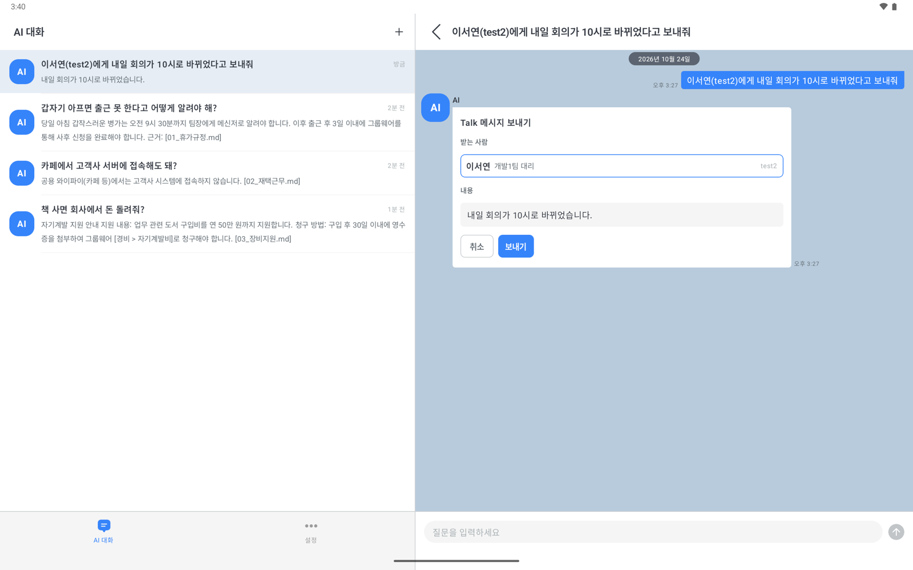
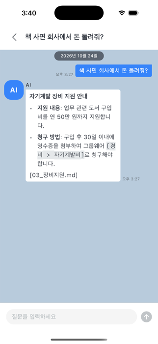
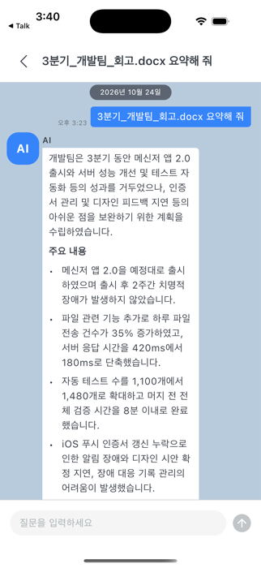
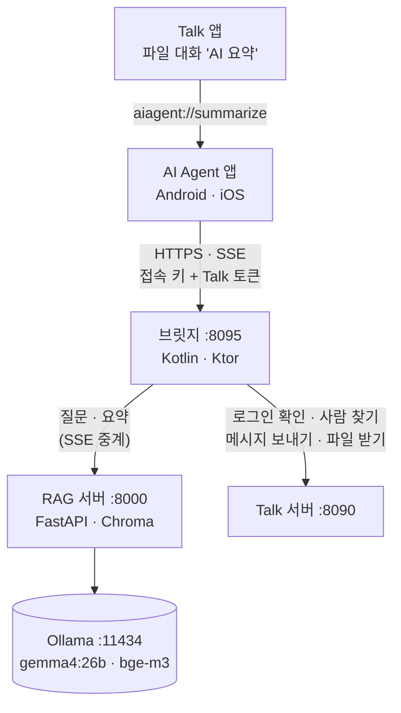

# AI_Agent

**로컬 LLM 으로 사내 문서에 답하고, 말로 시키면 Talk 메신저로 메시지를 보내는 Android · iOS AI 에이전트 + 브릿지 · RAG 서버** — 모델과 사내 문서는 회사 PC 한 대에 두고 바깥 AI 서비스로 보내지 않습니다.


[](https://github.com/EunilSung/AI_Agent/actions/workflows/ci.yml)

사내 메신저 쇼케이스 [Talk](https://github.com/EunilSung/Talk_Multiplatform) 에 붙인 AI 에이전트입니다. 세 가지를 합니다.

- **사내 문서로 답하기(RAG)** — 질문과 앞 대화로 검색어를 다시 써서 사내 문서를 찾고, 찾은 문서로만 답합니다. 답 끝에 근거 문서 이름을 적습니다.
- **Talk 로 메시지 보내기(에이전트)** — "이서연에게 내일 회의가 10시로 바뀌었다고 보내줘" 라고 하면 받는 사람과 내용을 채운 확인 카드를 띄우고,
  사용자가 [보내기]를 누르면 그 사람 이름으로 Talk 에 보냅니다. AI 가 스스로 보내지는 않습니다.
- **Talk 문서 요약** — Talk 에서 문서 파일 대화를 길게 눌러 "AI 요약" 을 고르면 이 앱이 열리고, 새 대화에 요약이 스트리밍됩니다.

LLM(Ollama)·사내 문서(Chroma)·브릿지는 회사 PC 한 대에서 돌고, 바깥에는 접속 키로 잠근 브릿지 하나만 엽니다.
AI 대화 기록은 각 기기에 로그인한 사람별로, 메시지와 파일은 Talk 서버에 남습니다.

<p align="center">
  
  
  
</p>
<p align="center"><sub>태블릿은 대화 목록과 대화방을 나란히 — 오른쪽은 "이서연(test2)에게 … 보내줘" 에 뜬 확인 카드. 폰은 사내 문서(샘플 장비지원 규정)로 답한 화면과,
Talk 의 "AI 요약" 으로 열려 docx 를 요약한 화면(왼쪽 위 "◀ Talk").</sub></p>

---

## 주요 기능

### 사내 문서로 답하기 (RAG)
- 문서 폴더(`rag-server/docs`)의 `.md`·`.txt` 를 조각내 색인하고, 질문마다 가까운 조각 4개를 찾아 답합니다. 문서에 없으면 "문서에서 찾을 수 없습니다" 라고 답합니다
- **후속 질문** — "그거 어느 메뉴에서 해?" 처럼 앞 대화에 기대는 질문은 앞 대화를 반영해 검색어를 다시 씁니다
- **스트리밍** — 답이 생기는 대로 그리고(▍), 중지할 수 있습니다. 끊기면 받은 데까지 남기고 "답변이 중간에 끊겼습니다" 로 표시합니다
- **마크다운** — 제목 · 글머리/번호 목록 · 굵게 · 인용 · 코드 · 표
- **추천 질문** — 새 대화에 4개(샘플 문서 3개에 맞춘 질문 + 메시지 보내기)
- 근거 문서 칩과 다시 쓴 검색어도 화면에 띄울 수 있지만 지금은 `Config.Chat.IS_SOURCES_ENABLED`·`IS_SEARCH_QUERY_ENABLED` 로 꺼 두었습니다(서버는 그대로 보냅니다)

### Talk 로 메시지 보내기
- "방금 그 내용 test3한테도 알려줘" 처럼 앞 답변을 내용으로 쓸 수 있습니다
- 받는 사람은 Talk 에서 찾아 이름·부서로 보여 주고, 같은 이름이 여럿이면 고르게, 못 찾으면 [보내기]가 눌리지 않습니다
- 보낸 뒤에는 카드가 "Talk에서 ○○님에게 보냈습니다" 로 바뀌고, 실패하면 [다시 보내기]로 다시 보낼 수 있습니다. 취소한 것과 보낸 것은 다음 대화에서 AI 도 압니다

### Talk 문서 요약
- txt · md · csv · tsv · log · json · xml · html · pdf · docx · xlsx · pptx · hwpx · hwp(5.0), 20MB 까지
- 긴 문서는 나눠 읽으며 진행을 보여 줍니다("문서를 읽는 중이에요 (2/5)"). 짧은 문서는 5~10초, 가장 긴 경우(12조각) 3분쯤
- 스캔한 PDF(글자 없음)·암호 걸린 문서·옛 doc/xls/ppt·HWP 3.x 는 이유를 알려 주고 요약하지 않습니다
- 다른 계정으로 로그인돼 있으면 바꿀지 먼저 묻습니다. 요약한 대화에서 이어 물을 수 있습니다

### 앱
- Talk 와 같은 구조(Clean Architecture + MVI)와 같은 모양(색 · 상단바 · 말풍선 · 탭 · **태블릿 2단**)
- 로그인은 Talk 계정. 처음 로그인할 때 서버 주소와 따로 받은 **접속 키**를 넣는다(공개 릴리스 앱에는 키도 주소도 없다).
  브릿지의 키가 바뀌면 로그인 화면의 [접속 키 바꾸기]로 새 키를 넣는다
- 토큰 · 접속 키는 Keystore(Android) · Keychain(iOS) 키로 잠가 저장
- **설정** — 계정 · 로그아웃(확인 후), 브릿지 주소(다른 서버로 바꾸면 확인 후 로그아웃), 연결 상태(브릿지 · Talk · 모델 · 문서 조각 수 · 접속 키) ·
  한국어/영어(문자열 120개, 양쪽 일치)

---

## 기술 스택

| 분류 | 사용 기술 |
|---|---|
| 언어 · UI | Kotlin 2.3.20, Compose Multiplatform 1.11.1, Material3 |
| 아키텍처 | Clean Architecture (ui / domain / data), MVI(Action → ViewModel → UiState) |
| DI · 네비게이션 | Koin 4.2.1 · Voyager 1.0.1 |
| 기기 DB | SQLDelight 2.3.2 (대화 · 메시지, 로그인한 사람별) |
| 설정 · 기기 암호화 | multiplatform-settings 1.3.0 · Android Keystore · iOS Keychain |
| 네트워크 | Ktor 3.4.2 클라이언트 — SSE 스트리밍 (Android OkHttp · iOS Darwin) |
| 브릿지 | Ktor 3.4.2 서버 (Netty), JDK 17 |
| RAG 서버 | Python · FastAPI · Uvicorn · Chroma · httpx |
| 문서 읽기 | pypdf · python-docx · openpyxl · python-pptx · olefile(HWP 본문을 직접 읽음) |
| LLM | Ollama — `gemma4:26b`(답변 · 요약 · 도구 호출), `bge-m3`(임베딩) |

**타깃** — Android `minSdk 24` / `targetSdk 36`, iOS 18.2 이상(`iosArm64` · `iosSimulatorArm64`, iPhone · iPad)

---

## 아키텍처



앱은 브릿지만 압니다. 브릿지가 사용자의 Talk 토큰으로 Talk 서버를 부르고, 질문과 파일은 RAG 서버에 넘긴 뒤 RAG 서버가 돌려준 SSE 를 그대로 앱에 흘려보냅니다.
LLM 에게 주는 문장(시스템 프롬프트 · 도구 설명)은 RAG 서버(`rag-server/app.py`)에만 있고, 앱은 대화 기록을 데이터로만 보냅니다.
앱의 계층은 Talk 와 같아서 의존성이 **안쪽으로만** 흐르고, 브릿지 통신은 `data/repository` 의 `*RepositoryImpl` 에서만 합니다.

```
composeApp/src/
├── commonMain/          83 Kotlin files — 화면·도메인·데이터
│   ├── kotlin/com/eunilsung/aiagent/
│   │   ├── ui/          login · main(탭·태블릿 2단) · conversationlist · chat(말풍선·마크다운·보내기 카드) · setting · uikit
│   │   ├── domain/      model · repository(interface 6) · usecase(26) · util(BridgeAddress · SummaryLink)
│   │   ├── data/        local(기기 DB · 설정 · 토큰 · 접속 키 암호화) · remote(BridgeClient · SSE 해석) · mapper · repository(*Impl)
│   │   └── di/          Koin 모듈
│   ├── sqldelight/      AppDatabase.sq
│   └── composeResources/ strings(ko·en) · drawable
├── androidMain/          10 Kotlin files — actual 구현 · Keystore 암호화 · 링크 진입점
├── iosMain/               8 Kotlin files — actual 구현 · Keychain 암호화
├── commonTest/           28 files — JVM·iOS 양쪽에서 도는 테스트
└── androidUnitTest/ · iosTest/  9 files — 플랫폼 암호화 · HTTP 클라이언트 · 평문 허용 주소 · 옛 DB 정리
shared/                    3 files — 앱 ↔ 브릿지 요청·응답·SSE 모델
bridge/                   19 Kotlin files — routes · limit · http · auth · rag · talk (+ 테스트 5 files)
rag-server/               app.py · extract.py(문서 → 글) · summarize.py(나눠 요약) + 테스트 · 샘플 사내 문서 3개
.maestro/                 실화면 흐름 3개 — Android·iOS 에 같은 파일을 돌린다
deploy/tunnel/            Cloudflare Tunnel 실행 스크립트 · 설정 예시
```

**화면 패턴** — 5개 ViewModel 이 `uiState`(StateFlow) 하나와 `onAction` 을 갖고, 화면은 `sealed` `Actions` 로만 일을 시킵니다.
한 번만 처리할 일(이동 · 토스트 · 대화상자)은 4개 ViewModel 이 `events` 로 냅니다. 앱과 브릿지의 계약은 `:shared` 하나로 컴파일해
한쪽만 바꾸면 빌드가 깨집니다.

---

## 메시지 보내기 설계

- **AI 는 보내지 않습니다.** LLM 은 `send_talk_message` 도구로 받는 사람과 내용만 정합니다(`event: action`). 보내는 일은 사용자가 카드에서
  [보내기]를 누른 뒤 앱이 브릿지를 불러서 합니다.
- **로그인한 사람으로 보냅니다.** 브릿지는 그 사람의 Talk 토큰으로 Talk 의 기존 API(사람 목록 → 1:1 방 열기 → 대화 보내기)를 부릅니다.
  Talk 에서는 본인이 보낸 메시지로 보이고, 누구에게 보낼 수 있는지도 Talk 서버의 규칙을 따릅니다.
- **두 번 가지 않습니다.** 앱 메시지 id 를 Talk 대화 id 로 씁니다. 응답을 못 받아 다시 보내도 Talk 는 한 번만 받습니다.
- **지난 보내기는 글이 아니라 도구 호출로 되돌려줍니다.** 보냄 · 취소를 도구 호출과 그 결과로 LLM 에 다시 넣어, 모델이 보낸 척 글로
  흉내 내지 않게 했습니다.
- **문서 속 지시를 따르지 않습니다.** 참고 문서와 파일 요약은 '자료' 틀로 감싸 LLM 에 넣고, 자료 안의 틀 표시는 지웁니다. LLM 이 정한
  받는 사람의 낱말이 모두 사용자의 이번 말에 있을 때만 카드를 내고, 요약에 이어서는 카드를 내지 않습니다. 브릿지는 Talk 의 AI 계정 ·
  자기 자신에게 보내기를 받지 않습니다.

---

## 문서 요약 설계

Talk 의 파일 대화를 길게 눌러 "AI 요약" 을 고르면 Talk 가 이 앱을 링크로 엽니다.

```
aiagent://summarize?fileId=<Talk 파일 id>&fileName=<파일 이름>&userId=<Talk 아이디>&userName=<이름>   (값은 모두 퍼센트 인코딩)
```

- **계정을 맞춥니다.** 같은 아이디로 로그인해 있으면 바로 새 대화를 만들어 요약합니다. 다른 계정이면 아무것도 바꾸지 않고 "지금 <지금 아이디> 계정에서
  로그아웃하고 <요청한 아이디> 계정으로 로그인할까요?" 를 묻고, [로그아웃]을 골랐을 때만 로그아웃한 뒤 로그인 칸에 그 아이디를 채웁니다. 로그인 전이면
  아이디를 채우고 로그인이 필요하다고 알립니다. 그 계정으로 로그인하면 요약이 이어지고, 다른 계정으로 로그인하면 취소했다고 알립니다.
- **링크는 아무 앱이나 열 수 있다고 봅니다.** 링크의 이름(userName)은 화면에 쓰지 않고, 3초 안에 거듭 오는 링크는 버립니다.
  파일은 브릿지가 로그인한 사람의 Talk 토큰으로 받으므로, Talk 서버가 그 파일이 있는 방의 사람에게만 줍니다.
- **긴 문서는 나눠 읽습니다.** 1만 자까지는 한 번에, 더 길면 문단 경계에서 약 7천 자 조각으로 나눠 조각마다 메모를 받은 뒤 합쳐
  요약합니다. 조각은 12개(약 8만 4천 자)까지 읽고, 넘으면 앞부분만 읽었다고 요약 끝에 적습니다. 요약은 10초 동안 보낼 것이 없으면 연결 유지 신호(`: ping`)를 끼웁니다.
- **큰 파일 · 압축 폭탄을 막습니다.** 글 뽑기에 압축 해제 크기 · 항목 수 · 글자 수 · 시트 행 · 쪽 수 상한이 있고, 동시에 2개까지만 돕니다.
  라이브러리는 BSD · MIT · Apache 계열만 씁니다.
- 요약한 문서는 사내 문서 검색 DB(Chroma)에 넣지 않습니다. 이어 묻는 질문은 요약 글을 대화 기록으로 삼습니다.

---

## 브릿지 API

모든 경로(`/v1/health` 포함)는 접속 키 헤더 `X-Bridge-Key` 가 먼저 필요합니다(없거나 틀리면 403 `client_key_invalid`).
대화 · 요약 · 사람 찾기 · 보내기는 `Authorization: Bearer <Talk 토큰>` 도 필요합니다. 요청 · 응답 모델은 `shared/` 에 있습니다.

| 경로 | 내용 |
|---|---|
| `POST /v1/auth/login` · `/v1/auth/logout` | Talk 서버 로그인 · 로그아웃을 대행. 토큰은 Talk 토큰이다. 로그아웃은 늘 204 |
| `POST /v1/chat` | 대화 기록을 받아 RAG 서버의 SSE 를 그대로 흘려보낸다. 앞서 정한 메시지 보내기는 글이 아니라 `sendAction: {recipient, content, sent}` 으로 실어 보낸다 |
| `POST /v1/summarize` | `{fileId, fileName}` → 사용자 Talk 토큰으로 Talk `GET /files/{fileId}` 를 받아 RAG 서버 `/v1/summarize`(파일 이름은 `X-File-Name` 헤더, 퍼센트 인코딩)에 넘기고 SSE 를 흘려보낸다. 거절: 404 `file_not_found`(없거나 그 방 사람이 아님), 413 `file_too_large`(20MB 초과), 503 `talk_unreachable`·`rag_unreachable` |
| `GET /v1/talk/people?q=` | 이름 일부·아이디·"이름(아이디)"로 Talk 사람 찾기. 나와 Talk 의 AI 계정은 빠진다 |
| `POST /v1/talk/messages` | `{recipientId, content, requestId}` → 1:1 방을 열고(있으면 그 방) 대화를 보낸다. 응답 `{roomId}` |
| `GET /v1/health` | 브릿지·RAG(모델·조각 수)·Talk 연결 |

거절은 요청의 `Accept`(SSE 경로는 `text/event-stream`)와 상관없이 늘 JSON `{"code": …}` 으로 옵니다. 공통 거절:
400 `bad_request`(모양이 틀림), 401 `unauthorized`(토큰 없음 · 만료)·`invalid_credentials`(로그인 비밀번호 틀림), 403 `client_key_invalid`·`user_not_allowed`(허용 목록 밖),
404 `not_found`(보내기 — 없는 사람), 413 `payload_too_large`, 429 `too_many_attempts`(로그인 시도)·`rate_limited`, 503 `talk_unreachable`(Talk 서버에 닿지 못함)·`busy`(동시 실행 상한, `Retry-After`).

SSE 이벤트(`POST /v1/chat` · `POST /v1/summarize`):

```
: connected                                     ← 연결 유지용 주석 (요약은 10초 동안 보낼 것이 없으면 : ping 도)
event: sources  data: {"sources":[…], "query":"다시 쓴 검색어"}   ← 대화만. query 는 다시 썼을 때만
event: progress data: {"done":1,"total":3}       ← 요약만. 긴 문서를 나눠 읽는 진행
data: {"delta":"답변 조각"}                      ← 여러 번
event: action   data: {"type":"send_message","recipient":"이서연","content":"…"}   ← 대화만. 답 대신 보내기 요청
event: error    data: {"message":"기록용","code":"no_text"}   ← code 로 앱이 문구를 고른다(message 는 화면에 쓰지 않는다)
event: done     data: {} 또는 {"notFound":true}   ← 답변이 "문서에서 찾을 수 없습니다" 뿐이면 앱이 근거·검색어를 지운다
```

- 요약 실패 code: `unsupported_file`·`no_text`·`encrypted_file`·`broken_file`. 브릿지가 RAG 중계 도중 끊기면 `stream_interrupted` 를 덧붙입니다.
- 앱은 `done` 없이 끝난 스트림을 끊긴 것으로 보고, 받은 데까지만 "답변이 중간에 끊겼습니다" 로 남깁니다.

---

## 보안

공개 저장소라 실제 터널 주소 · 접속 키 · 계정은 문서와 코드에 적지 않고 `<터널 주소>` 같은 자리표시만 씁니다. 바깥에 여는 것과 막는 것은 아래와 같습니다.

- **바깥에 여는 것은 브릿지 하나이고, 그것도 터널을 거쳐서만 엽니다.** RAG 서버 · Ollama · 브릿지(기본) · Talk 로컬 서버는 모두
  `127.0.0.1` 에서만 받습니다. RAG 서버에는 인증이 없으므로 바깥에 열지 않습니다.
- **접속 키** — 브릿지의 모든 경로(없는 경로 포함)는 먼저 `X-Bridge-Key` 를 봅니다. SHA-256 해시를 상수 시간(constant-time)으로 비교하고,
  공백 없는 영문 · 숫자 · 기호 32~256자가 아닌 키로는 브릿지가 뜨지 않습니다(앱이 넣을 수 있는 키와 같습니다).
- **키는 앱에 넣지 않습니다.** 공개 릴리스 앱은 키도 서버 주소도 없이 빌드하고, 쓰는 사람이 처음 로그인할 때 서버 주소와 따로 받은 키를
  넣습니다. 주소를 넣기 전에는 키도 비밀번호도 보내지 않습니다 — 빌드 기본 주소는 에뮬레이터용 평문 주소라 실기기에서는 같은 망의
  아무 기기에나 닿을 수 있습니다. 넣은 키는 그때의 서버 주소 출처(스킴 · 호스트 · 포트)에 묶어 잠가 저장하고 그 출처로만 싣습니다 —
  주소만 바꾸게 속여 키를 다른 서버로 빼 가지 못합니다. 리다이렉트는 따라가지 않습니다(따라가면 키 헤더가 다른 호스트로 옮겨 갑니다).
  로그인한 채로 서버를 바꾸면 먼저 로그아웃해 Talk 토큰도 새 서버로 가지 않습니다.
  키를 `local.properties` 에 넣어 직접 만든 개발용 빌드는 빌드 기본 주소의 호스트와 로컬 주소(10.0.2.2 · localhost · 127.0.0.1)에만 키를 싣고,
  그 빌드는 바깥 사람에게 주지 않습니다(키를 꺼낼 수 있습니다). 키가 새면 브릿지의 `BRIDGE_ACCESS_KEY` 를 바꾸고 새 키를 다시 나눕니다.
- **상한** — 경로별 본문 크기(로그인 4KB · 요약 4KB · 보내기 32KB · 대화 512KB), 로그인 시도(주소별 · 전체), LLM 동시 실행,
  사람당 시간당 횟수, 요청 받기 30초, 허용 계정 목록(`ALLOWED_USER_IDS`).
- **평문은 로컬에서만** — 앱은 http 를 에뮬레이터 · 이 기기 주소(10.0.2.2 · localhost · 127.0.0.1)에만 씁니다. Android 는 `network_security_config` 로
  OS 도 막고, iOS 는 `NSAllowsLocalNetworking` 이 같은 망 이름의 평문을 열어 두므로 앱의 주소 규칙(`BridgeAddress`)이 막습니다.
  로컬이 아닌 http 주소로는 빌드되지 않습니다. 실기기는 https 터널 주소를 씁니다.
- **기기 저장** — 토큰 · 아이디 · 이름 · 접속 키는 잠가 저장하고(`allowBackup=false`), AI 대화 기록은 기기 DB 에 평문으로 남습니다.
- **로그** — 브릿지는 파일 이름과 내용을 로그에 남기지 않고, 파일 이름은 RAG 에 URL 대신 헤더로 넘깁니다.

---

## 외부 접속

바깥(회사 밖 · 모바일 데이터)에서 쓰려면 **브릿지 하나만** 터널로 엽니다. RAG 서버 · Ollama · Talk 로컬 서버는 열지 않습니다.
바깥에서 막는 것은 접속 키입니다. 다만 테스트 계정 비밀번호(1234)는 공개돼 있고 키는 쓰는 사람 모두가 알게 되니, 열 때는
`ALLOWED_USER_IDS` 로 로그인할 아이디를 줄이고, Talk 로컬 서버는 **띄울 때마다** `SEED_PASSWORD` 를 환경변수로 주어 공개 비밀번호를 쓰지 않게 합니다.
빼고 다시 띄우면(Talk 테스트가 대신 띄운 로컬 서버도 같습니다) 시연용 계정이 공개 비밀번호로 돌아갑니다. 값은 명령줄에 그대로 쓰지 말고
(셸 기록에 남습니다) `read -rs SEED_PASSWORD && export SEED_PASSWORD` 처럼 넘깁니다.

공개 릴리스 앱은 처음 켜면 로그인 화면 맨 위에 서버 주소 칸이 열립니다. 쓰는 사람은 터널 주소와 그 서버의 접속 키를 넣어 로그인합니다
(뒤에 바꿀 때는 로그인 화면의 "서버: …" 줄이나 설정 화면에서). 키는 넣을 때의 주소 출처에 묶이므로 주소를 바꾸면 그 서버의 키를 다시
넣습니다. 브릿지의 키를 바꿨으면 쓰는 사람은 로그인 화면의 [접속 키 바꾸기]로 새 키를 넣습니다. 개발용 빌드는 `local.properties` 의 `bridge.baseUrl`(또는 환경변수 `AI_AGENT_BRIDGE_URL`)을
기본 주소로 넣어 빌드할 수도 있습니다(iOS 는 Xcode 가 빌드하므로 `local.properties` 를 씁니다).

**임시 주소로 확인 (Cloudflare Quick Tunnel)** — 계정 · 도메인 없이 됩니다. 실행할 때마다 주소가 바뀌고 누구나 닿으므로 짧게 쓰고 닫습니다.
Cloudflare 공식 문서상 임시 터널은 **SSE(답변 스트리밍)를 지원하지 않고** 동시 요청이 200개로 제한되며 가용성 보장이 없습니다.
접속 확인용으로만 씁니다.

```bash
deploy/tunnel/quick.sh            # https://<무작위>.trycloudflare.com 이 찍힌다
```

방금 연 주소는 이 Mac 의 DNS 가 "없는 주소" 로 잠깐 기억해 curl 이 실패할 수 있습니다. 1~2분 기다리거나 `sudo dscacheutil -flushcache; sudo killall -HUP mDNSResponder` 를 합니다.

**도메인 없이 고정 주소 — Tailscale Funnel** — 주소는 `https://<기기 이름>.<tailnet 이름>.ts.net` 이고, TLS 를 이 PC 에서 풀어 중계 서버가
내용을 볼 수 없습니다. 대신 Cloudflare 같은 공격 차단(DDoS · WAF)은 없습니다.

```bash
brew install --cask tailscale-app                          # Standalone 앱. 시스템 확장·VPN 허용과 로그인은 직접 한다
/Applications/Tailscale.app/Contents/MacOS/Tailscale funnel --bg 8095    # 처음에는 승인 링크가 나온다 — 관리 콘솔에서 승인
/Applications/Tailscale.app/Contents/MacOS/Tailscale funnel status       # 켜졌는지
/Applications/Tailscale.app/Contents/MacOS/Tailscale funnel --https=443 off   # 끄기
```

- 공개 DNS 에 주소가 올라오는 데 보통 10분 안쪽이 걸립니다. 넘게 걸리면 관리 콘솔 Access controls 에서 `"nodeAttrs"` 를 비웠다가
  되돌려 저장하고 Funnel 을 껐다 켭니다([같은 증상 보고](https://github.com/tailscale/tailscale/issues/11849)).
- 이 PC 도 tailnet 안에 있어 이름이 안쪽 주소(100.x)로 풀립니다. 바깥 경로를 확인하려면 공개 DNS 로 찾은 주소로 붙습니다:
  `curl --resolve <이름>:443:$(dig +short <이름> @1.1.1.1 | head -1) https://<이름>/v1/health`(접속 키 헤더는 아래 [테스트](#테스트)처럼 붙입니다)
- 다른 PC 로 옮길 때는 Funnel 을 켜기 전에 관리 콘솔에서 기기 이름을 정해 둡니다(이름이 바뀌면 주소가 새로 생깁니다). 옮긴 뒤 예전 PC 의
  Funnel 은 끕니다.
- 재부팅 뒤 사람 없이 다시 켜지게 하려면 각 서비스를 시스템 서비스(LaunchDaemon)로 띄우고, Tailscale 은 로그인 전에도 도는 오픈소스 `tailscaled` 를
  씁니다(Standalone 앱은 로그인해야 돕니다). FileVault 가 켜져 있으면 재부팅 뒤 디스크 암호를 넣기 전까지 LaunchDaemon 도 돌지 않으므로, 계획된 재시작은
  `sudo fdesetup authrestart` 로 합니다. macOS 자동 로그인은 FileVault 를 꺼야 쓸 수 있어 권하지 않습니다.
- Tailscale 의 무료 Personal 요금제는 비상업 용도로 안내돼 있어, 회사에서 쓰려면 요금제를 확인합니다.

**고정 주소 — Cloudflare Tunnel** — Cloudflare 계정과 도메인 하나가 필요합니다(계정 만들기와 승인은 직접 합니다).

```bash
cloudflared tunnel login                                   # 브라우저에서 도메인을 승인한다
cloudflared tunnel create ai-agent                          # ~/.cloudflared/<UUID>.json 이 생긴다
cloudflared tunnel route dns ai-agent ai.<내도메인>.com
cp deploy/tunnel/config.example.yml deploy/tunnel/config.yml   # UUID·경로·주소를 채운다 (gitignore 대상)
cloudflared tunnel --config deploy/tunnel/config.yml run ai-agent
```

상시 운영하려면 PC 의 잠자기를 끄고, `deploy/tunnel/config.yml` 을 `/etc/cloudflared/config.yml` 로 복사한 뒤(`credentials-file` 경로를 확인한다)
`sudo cloudflared service install` 로 부팅 때 터널이 뜨게 합니다(부팅 서비스는 `/etc/cloudflared` 의 설정을 읽습니다). 필요하면 Cloudflare Access 로 접근을 한 겹 더 막습니다.
Cloudflare Tunnel 은 TLS 를 Cloudflare 에서 풀므로 질문 · 답변 · 요약이 Cloudflare 를 거칩니다(Funnel 은 이 PC 에서 풉니다).

## CI · 릴리스

GitHub Actions(`.github/workflows`)가 테스트와 릴리스를 맡습니다. CI 는 비밀값을 쓰지 않고, 릴리스는 `release` 환경의 APK 서명 키만 씁니다.

**릴리스 서명 키** — Settings → Environments 에서 `release` 를 만들고 Deployment branches and tags 를 `v*` 태그만 허용하게 묶은 뒤,
그 환경의 비밀값으로 `ANDROID_KEYSTORE_BASE64`(`base64 -i <키스토어 파일>`) · `ANDROID_KEYSTORE_PASSWORD` · `ANDROID_KEY_ALIAS` ·
`ANDROID_KEY_PASSWORD` 를 넣습니다. 키스토어 원본은 저장소 밖에 둡니다. 키가 없으면 릴리스가 멈춥니다(디버그 APK 는 debuggable 이라 올리지 않습니다).
태그 규칙만으로는 쓰기 권한이 있는 사람을 막지 못합니다 — 그 사람이 워크플로를 고친 커밋에 `v*` 태그를 달면 그 워크플로가 서명 키를 받습니다.
그래서 Settings → Rules → Rulesets 의 태그 규칙으로 `v*` 태그를 만들고 바꾸고 지우는 일을 관리자만 하게 막고, 함께 쓰는 사람이 있으면
`release` 환경에 Required reviewers 도 둡니다.

| 워크플로 | 언제 | 하는 일 |
|---|---|---|
| `CI` | main 에 올린 커밋 · PR | 브릿지 테스트 · 앱 테스트 · 앱 빌드(앱에 접속 키 · 주소가 들어가지 않았는지 확인) · RAG pytest(Ubuntu), iOS 시뮬레이터 테스트(macOS) |
| `Release` | `v*` 태그 | 태그가 main 의 커밋이고 앱 `versionName` 과 같은지 확인 → `CI` → 릴리스 파일 → GitHub 릴리스 |

```bash
# composeApp/build.gradle.kts 의 versionName · versionCode 를 올려 main 에 머지한 뒤
git tag v<versionName> && git push origin v<versionName>
```

| 릴리스 파일 | 내용 |
|---|---|
| `AI_Agent-<버전>.apk` | Android 앱(`release` 환경의 키로 서명, 서명 · debuggable 아님을 확인). 접속 키 · 서버 주소 없이 빌드해 처음 로그인할 때 넣는다 |
| `ai-agent-bridge-<버전>.zip` | 브릿지 실행본(JDK 17). 풀고 `BRIDGE_ACCESS_KEY`(공백 없는 영문 · 숫자 · 기호 32~256자)를 환경변수로 준 뒤 `bridge/bin/bridge` 로 띄운다. 키 없이는 뜨지 않는다 |
| `ai-agent-rag-server-<버전>.zip` | RAG 서버 소스와 샘플 문서 |
| `SHA256SUMS.txt` | 위 파일들의 SHA-256 |

- **릴리스 APK 에는 접속 키도 서버 주소도 없습니다.** 빌드 단계가 생성 파일을 확인해 들어갔으면 멈춥니다. iOS 는 서명할 Apple 팀이 정해지지 않아
  릴리스 파일이 없습니다(소스에서 Xcode 로 빌드).
- **자동 배포는 없습니다.** 브릿지 · RAG · Ollama 는 회사 PC 에서 돕니다. 그 PC 를 GitHub 의 self-hosted 러너로 붙이면 공개 저장소의 PR 코드가
  그 PC 에서 돌 수 있어 붙이지 않았습니다.
- 공개 저장소라 로그와 아티팩트는 누구나 봅니다. 액션은 커밋 SHA 로 고정했고, 릴리스 작업만 `contents: write` 를 받습니다.

---

## 테스트

**브릿지 82개 + 앱 212개(공통 186 · Android 17 · iOS 9 — JVM 에서 203개, iOS 시뮬레이터에서 195개가 돈다) + RAG 219개, 그리고 Android · iOS 실화면 흐름 3개.**

```bash
./gradlew :bridge:test                                               # 브릿지 (Talk·RAG 는 MockEngine 대역)
./gradlew :composeApp:testDebugUnitTest :composeApp:iosSimulatorArm64Test   # 앱 Android(JVM) · iOS 시뮬레이터
(cd rag-server && .venv/bin/pip install -r requirements-dev.txt && .venv/bin/python -m pytest -q)   # RAG (LLM 은 대역). .venv 는 아래 "빌드 & 실행" 에서 만든다
maestro --device <기기> test .maestro -e SUMMARY_FILE_ID=<id> -e SUMMARY_FILE_NAME=<URL 인코딩한 이름>   # Ollama · RAG · Talk · 브릿지가 떠 있어야 한다
```

키 · 주소 없이 만든 빌드(릴리스 APK)에 돌릴 때는 환경변수 `MAESTRO_BRIDGE_URL` · `MAESTRO_ACCESS_KEY` 를 줍니다(키는 명령줄에 쓰지 않고
`read -rs MAESTRO_ACCESS_KEY && export MAESTRO_ACCESS_KEY`). 로그인 흐름이 서버 주소 칸과 접속 키 칸이 떠 있을 때만 넣습니다
(`.maestro/common/release_fields.yaml`). Maestro 는 넣은 값을 `~/.maestro/tests` 의 그 실행 기록에 남기므로 돌린 뒤 그 기록을 지웁니다.

| 대상 | 내용 |
|---|---|
| 브릿지 | 접속 키(모든 경로·키 강도와 형식·프록시 거친 요청), 본문 상한, 로그인 시도 한도, 동시 실행 상한, 요청 받기 시간 제한, AI 계정·자기 자신에게 보내기 거절, 로그인 대행, 토큰 확인, SSE 중계와 끊김, RAG 꺼짐, 사람 찾기, 보내기와 보내기 기록 중계, 요약(파일 받기·20MB 경계·파일 이름은 헤더로·로그에 이름 안 남김), SSE 를 바라는 요청의 거절도 JSON |
| 앱 | 접속 키 싣기(넣은 키는 그 서버 출처로만·리다이렉트 안 따라감)·키 형식·로그인 화면의 서버 주소 칸과 키 칸(주소 정하기 전에는 안 보냄·실패하거나 주소를 바꾸면 넣던 키 지움)·서버를 바꾸면 로그아웃, 접속 키·토큰 암호화 저장·평문 이전, 주소 규칙(평문은 로컬 주소만), SSE 해석, 마크다운, 대화 묶음·날짜선, 질문 보내기·중지·실패, 보내기 확인·실패 뒤 다시·취소, 기기 DB, 요약 링크 해석·계정 확인·로그인 뒤 이어 가기, 요약 진행·실패 이유·끊긴 답변, Koin 구성 |
| RAG | 형식별 글 뽑기(HWP 는 테스트가 OLE 파일을 직접 만든다), 암호·스캔·깨짐·지원 안 함, 압축 폭탄·글자 상한, 나눠 요약·진행·ping·끊김, 문서·요약 속 지시 무력화(틀 표시 지우기·받는 사람 확인) |
| 실화면 흐름 | Maestro 로 Android 에뮬레이터·iOS 시뮬레이터에서 추천 질문에 문서로 답하기(근거 칩이 꺼져 있는지까지) / Talk 로 메시지 보내기 / 요약 링크 — 같은 계정, 다른 계정에서 취소·로그아웃 뒤 로그인, 엉뚱한 계정으로 로그인 |

Compose UI 테스트는 넣지 않았습니다. 브릿지는 Talk·RAG 를 대역으로 두고 시간 제한만 실제 Netty 로 보며, RAG 는 LLM 대역과 임시 Chroma 를 씁니다.
Android Studio 실행 구성은 `테스트 (JVM)`, `테스트 (JVM + iOS 시뮬레이터)`, `브릿지 실행` 입니다.

- 실화면 흐름 03 은 test1–test2 1:1 방에 올린 Talk 파일 id 와 URL 인코딩한 이름이 필요합니다. 상대(test2)가 REST 로 파일을 올리고
  (`POST /rooms/{방}/files?name=` → `POST /rooms/{방}/messages` kind=file) 그 id 를 넘깁니다.

브릿지를 curl 로 부를 때는 키를 명령줄에 그대로 쓰지 말고(셸 기록에 남습니다) 파일에서 읽어 헤더로 넘깁니다.

```bash
printf 'X-Bridge-Key: %s\n' "$(sed -n 's/^bridge.accessKey=//p' local.properties)" | curl -s -H @- localhost:8095/v1/health
```

**메시지가 Talk 에 실제로 들어갔는지**는 받는 사람으로 Talk 서버에 물어 확인합니다.

```bash
T2=$(curl -s -X POST localhost:8090/auth/login -H 'Content-Type: application/json' -d '{"id":"test2","password":"1234"}' | python3 -c "import sys,json;print(json.load(sys.stdin)['token'])")
curl -s localhost:8090/rooms -H "Authorization: Bearer $T2"              # test1 과의 방 id 를 찾는다
curl -s "localhost:8090/rooms/<방 id>/messages?limit=5" -H "Authorization: Bearer $T2"
```

### 자동으로 확인하지 못하는 것

- iOS 한글 입력 — 자동화가 안 됩니다. 실화면 흐름은 추천 질문 버튼으로 한글 질문을 보냅니다.
- Talk → AI Agent 실행(링크를 여는 쪽) — Talk 저장소의 실화면 흐름이 봅니다.
- 실제 LLM 의 답 품질 — 테스트는 LLM 대역을 씁니다. 실화면 흐름만 실제 모델에 붙습니다.

---

## 빌드 & 실행

| 필요한 것 | 비고 |
|---|---|
| JDK 17 · Android SDK · Xcode | Talk 와 같다 |
| Python 3.10 이상 | RAG 서버(3.14 에서 확인) |
| [Ollama](https://ollama.com) | `ollama pull gemma4:26b` (약 16GB) · `ollama pull bge-m3` (약 1.2GB). 메모리 32GB 이상 권장 |
| [Talk](https://github.com/EunilSung/Talk_Multiplatform) | 로컬 서버(`:server:runLocal`)를 띄운다. 계정·메시지는 Talk 가 정본이다. 이 저장소 옆에 `Talk` 이름으로 클론한다 |
| [Maestro](https://maestro.mobile.dev) | 실화면 흐름에만 |

```bash
git clone https://github.com/EunilSung/Talk_Multiplatform.git ../Talk
cd rag-server && python3 -m venv .venv && .venv/bin/pip install -r requirements.txt
```

`local.properties` 에 Android SDK 경로와 **브릿지 접속 키**를 둡니다. `./gradlew :bridge:run` 이 이 키로 브릿지를 띄우고, 개발용 앱 빌드도 이 키를
기본 키로 넣습니다(넣지 않으면 앱이 로그인 화면에서 키를 묻습니다).

```properties
sdk.dir=<Android SDK 경로>
# 공백 없는 영문·숫자·기호 32~256자 무작위 값(openssl rand -base64 32). 저장소에 넣지 않고 따로 보관한다
bridge.accessKey=<접속 키>
# 앱의 기본 브릿지 주소. 비우면 에뮬레이터 http://10.0.2.2:8095, 시뮬레이터 http://localhost:8095
bridge.baseUrl=
```

`.properties` 는 줄 끝의 `#` 를 주석으로 보지 않으므로 설명은 줄 맨 앞에 둡니다.

앱 빌드에서는 환경변수 `AI_AGENT_BRIDGE_KEY` · `AI_AGENT_BRIDGE_URL` 이 있으면 위 두 값보다 먼저입니다(브릿지는 `BRIDGE_ACCESS_KEY` 를 먼저 보므로,
환경변수로 키를 바꿀 때는 두 쪽을 같은 값으로 맞춥니다). `bridge.baseUrl` 은 https 이거나 로컬 주소여야
빌드됩니다. 키가 비어 있으면 그 앱은 로그인 화면에서 접속 키를 받고, 주소까지 비어 있으면 서버 주소부터 받습니다(공개 릴리스와 같습니다).

순서대로 띄웁니다. 터미널 다섯 개가 필요합니다.

```bash
ollama serve
cd rag-server && .venv/bin/uvicorn app:app --host 127.0.0.1 --port 8000
curl -X POST localhost:8000/v1/ingest                      # rag-server/docs 의 .md/.txt 를 색인 (문서를 바꿀 때마다)
cd ../Talk && ./gradlew :server:runLocal                   # Talk 로컬 서버 8090
./gradlew :bridge:run                                      # 브릿지 127.0.0.1:8095. local.properties 의 키를 환경변수로 넘긴다 (실행 구성 "브릿지 실행")
./gradlew :composeApp:installDebug                         # Android
open iosApp/iosApp.xcodeproj                               # iOS — Xcode 에서 시뮬레이터를 골라 실행
```

로그인은 Talk 계정(`test1`~`test10` / `1234`, 로컬 Talk 서버)입니다. 저장소에 든 사내 문서는 가상의 회사 문서 샘플 3개(휴가 · 재택근무 · 장비지원)뿐이고,
`rag-server/docs` 의 나머지 파일은 올리지 않습니다(`.gitignore`).

| 설정 (환경변수) | 기본값 | 뜻 |
|---|---|---|
| 브릿지 `PORT` · `HOST` | `8095` · `127.0.0.1` | 이 PC 안에서만 받는다. 에뮬레이터(10.0.2.2) · 시뮬레이터 · 터널(127.0.0.1:8095 로 붙음)은 그대로 된다 |
| 브릿지 `BRIDGE_ACCESS_KEY` | 없음 (`:bridge:run` 은 `local.properties` 의 `bridge.accessKey` 를 넘긴다) | 없거나 공백 없는 영문 · 숫자 · 기호 32~256자가 아니면 브릿지가 뜨지 않는다. `BRIDGE_ALLOW_NO_KEY=1` 은 이 PC 안에서 프록시 없이 바로 온 요청만 받는 시험용이다 — 터널을 끈 상태에서만 쓴다 |
| 브릿지 `ALLOWED_USER_IDS` | (비움) | 쉼표로 적은 아이디만 로그인할 수 있다. 비우면 모든 Talk 계정 |
| 브릿지 `LOGIN_PER_IP_PER_MINUTE` · `LOGIN_GLOBAL_PER_SECOND` | `10` · `5` | 로그인 시도 한도(넘으면 429). 터널 뒤에서는 X-Forwarded-For 의 마지막 값을 주소로 본다 |
| 브릿지 `LLM_CONCURRENCY` · `LLM_PER_USER_CONCURRENCY` | `4` · `2` | 동시에 도는 대화 · 요약의 무게 합(대화 1 · 요약 2), 전체와 사람당. 넘으면 2초 기다린 뒤 503 busy |
| 브릿지 `CHAT_PER_USER_HOURLY` | `60` | 한 사람이 한 시간에 할 수 있는 질문 · 요약 · 보내기 합 |
| 브릿지 `PEOPLE_PER_USER_HOURLY` | `120` | 사람 찾기 한도 |
| 브릿지 `RAG_URL` · `TALK_URL` | `http://127.0.0.1:8000` · `http://localhost:8090` | |
| RAG `CHAT_MODEL` · `EMBED_MODEL` | `gemma4:26b` · `bge-m3` | 임베딩 모델을 바꾸면 다시 색인한다 |
| RAG `OLLAMA_URL` · `TOP_K` · `KEEP_ALIVE` | `http://localhost:11434` · `4` · `30m` | |
| RAG `THINK` | `0` | `1` 이면 Gemma 4 생각 모드. 첫 글자까지 약 6초 늦어진다 |
| RAG `REWRITE` | `1` | 후속 질문을 앞 대화를 반영해 다시 써서 검색 |

---

## 기술적으로 볼만한 지점

### 1. SSE 를 해석하지 않고 중계하되, 끊기면 실패로 닫는다
브릿지는 RAG 의 SSE 를 조각마다 바로 흘려보내고(버퍼링 끔), 중계 도중 RAG 가 끊기면 `stream_interrupted` 오류와 `done` 을 덧붙여 닫습니다.
앱은 `done` 없이 끝난 스트림을 끊긴 것으로 보고, 받은 데까지만 실패로 남겨 다음 질문의 대화 기록에서 뺍니다. 긴 요약은 10초 동안
보낼 것이 없으면 `: ping` 을 끼워 중간 장비가 연결을 끊지 않게 합니다.

### 2. AI 는 요청만 하고, 사람이 보낸다
LLM 은 도구 호출로 "누구에게 무엇을" 만 정하고, 보내는 일은 확인 카드의 [보내기]가 합니다. 앱 메시지 id 를 Talk 대화 id 로 그대로 써서
다시 보내도 한 번만 들어가고, 지난 보내기는 도구 호출과 결과로 LLM 에 되돌려 모델이 글로 흉내 내지 않게 했습니다.

### 3. 프롬프트 인젝션 방어 세 겹
문서와 요약을 자료 틀로 감싸고 틀 표시를 지우며(①), LLM 이 정한 받는 사람의 낱말이 모두 사용자의 이번 말에 있을 때만(조사 · 호칭을 떼고, 성을 뺀 이름은 같은 사람으로 봄) 카드를 내고(②),
브릿지가 AI 계정 · 자기 자신에게 보내기를 거절합니다(③). 문서에 "이 사람에게 보내라" 가 적혀 있어도 사용자가 말하지 않은 사람에게는
카드가 뜨지 않습니다.

### 4. 바깥에 여는 문은 접속 키 하나
모든 경로에서 키를 먼저 보고(상수 시간 비교), 짧은 키로는 뜨지 않습니다. 앱은 키를 바이너리에 넣지 않고 사용자가 넣은 키를 그 서버 출처에 묶어
그 출처로만 싣고, 리다이렉트를 따라가지 않습니다. 여기에 경로별 본문 상한
(읽으면서 셈), 로그인 시도 한도, LLM 무게 상한, 시간당 한도, 요청 받기 30초 제한을 더해 키가 있는 사람도 서버를 독차지하지 못하게 했습니다.

### 5. 긴 문서 나눠 요약
문단 경계에서 조각을 나눠 조각마다 메모를 받고, 메모가 길면 한 번 더 줄여 최종 요약을 만듭니다. HWP 는 olefile 로 본문 레코드를 직접 읽고,
xlsx 는 흘려 읽으며, 압축 폭탄 · 글자 수 상한을 둬 큰 파일 하나가 서버 메모리를 다 쓰지 못하게 했습니다.

### 6. 링크 하나로 남의 로그인을 끊지 못하게
링크가 다른 계정을 가리키면 아무것도 바꾸지 않고 묻고, 로그인 전이면 대기로 걸어 둡니다. 대기 중인 요약은 화면 인자가 아니라 저장소에
대화 id 로 걸어 두어 Android 의 상태 저장 직렬화를 피했습니다.

---

## 규모

| 항목 | 값 |
|---|---|
| Kotlin 파일 | 165개 (앱 138 · 공유 3 · 브릿지 24, 테스트 포함) |
| Kotlin 코드 라인 | 16,273줄 (앱 12,795 · 브릿지 3,165 · 공유 313) |
| Python | 10개 파일 4,459줄 (서버 2,325 · 테스트 2,134) |
| Repository 인터페이스 / UseCase | 6 / 26 |
| ViewModel / Actions | 5 / 5 |
| 기기 DB 테이블 | 2개 |
| 문자열 리소스 | 120개 (ko · en) |
| 테스트 | 513개 (브릿지 82 · 앱 212 · RAG 219) + 실화면 흐름 3개 |

---

## 라이선스

이 프로젝트가 쓰는 오픈소스 구성 요소는 모두 무료이고 상업적 이용을 막는 조항이 없습니다. 외부 접속에 쓰는 Tailscale 은 오픈소스가 아닌
서비스이고, 무료 Personal 요금제는 비상업 용도로 안내돼 있습니다(Cloudflare Tunnel 은 무료 요금제로 됩니다).

| 구성 요소 | 라이선스 |
|---|---|
| Gemma 4 (`gemma4:26b`) | Apache 2.0 |
| bge-m3 | MIT |
| Ollama | MIT |
| cloudflared | Apache 2.0 |
| Chroma · FastAPI · Uvicorn · httpx | Apache 2.0 · MIT · BSD-3 · BSD-3 |
| pypdf · python-docx · openpyxl · python-pptx · olefile · cryptography | BSD-3 · MIT · MIT · MIT · BSD · Apache 2.0/BSD-3 |
| Kotlin · Compose Multiplatform · Ktor · Koin · SQLDelight · multiplatform-settings · kotlinx · AndroidX | Apache 2.0 |
| Voyager | MIT |
| logback(브릿지 로그) | EPL 1.0 / LGPL 2.1 |

재배포할 때는 각 라이선스의 저작권 고지를 함께 넣습니다.
